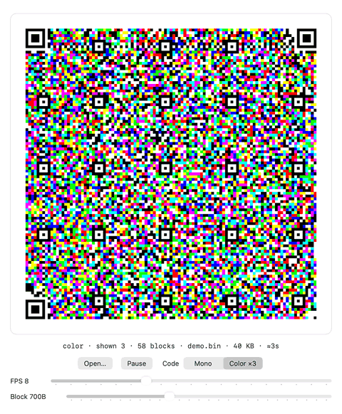

# QrTransfer

[简体中文](README.zh-CN.md) · [Project homepage](https://qrtransfer.github.io/)

Send a file from a Mac or Windows PC to an iPhone using the computer’s screen and the iPhone’s camera. Once both apps are installed, transfers work without Wi-Fi, Bluetooth, a cable, or a cloud upload.

## Download

Get QrSender for Windows (x64 or ARM64) or macOS (Apple silicon or Intel) from [GitHub Releases](https://github.com/QrTransfer/QrTransfer/releases/latest).

## Build from source

| App | Requirements | Build |
| --- | --- | --- |
| [QrSender](QrSender/) | macOS 13 or later and Swift 5.9 or later | From `QrSender`, run `swift run QrSender` or run `./build-app.sh` to produce `QrSender.app`. |
| [QrSender for Windows](QrSender.Windows/) | Windows with the .NET 10 SDK | Run `dotnet run --project QrSender.Windows` from the repository root. |
| [QrReceiver](QrReceiver/) | An iPhone running iOS 16 or later and Xcode | Open [QrReceiver.xcodeproj](QrReceiver/QrReceiver.xcodeproj), select your development team under **Signing & Capabilities**, choose your iPhone, and click **Run**. |

## Send a file

1. On the computer, open or drop a small file into **QrSender** and click **Play**.
2. On the iPhone, open **QrReceiver**, allow camera access, and hold the on-screen code in view. The app detects monochrome and color codes automatically.
3. When verification completes, use the iOS share sheet to save or open the file.

If scanning stalls, switch QrSender to **Mono**, lower the frame rate, or reduce the block size. Keep the full QR image visible and avoid glare. Actual speed depends on the screen, camera, file, and scan conditions.

## Protocol and tests

Both apps use **QRT2**. Update both together if you have an older QRT1 build. QRT2 uses LT fountain coding to recover missing blocks from later symbols. Color mode overlays up to three independent QR payloads in each image. QrReceiver checks the finished file against its SHA-256 checksum.

See the [sender documentation](QrSender/README.md) for the wire format and settings. On macOS, run `swift test --package-path QrSender` from the repository root to test the codec and color rendering. See the [Windows sender documentation](QrSender.Windows/README.md) for Windows build and publish commands.
