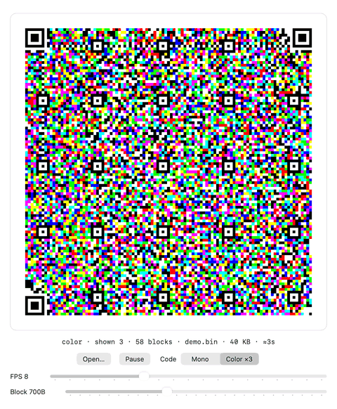

# QrTransfer

[English](README.md) · [项目主页](https://qrtransfer.github.io/#zh-cn)

用 Mac 的屏幕和 iPhone 的摄像头传送文件。两端应用安装后，传输无需 Wi‑Fi、蓝牙、数据线或上传云端。

## 从源码构建

| 应用 | 系统要求 | 构建方法 |
| --- | --- | --- |
| [QrSender](QrSender/) | macOS 13 或更新版本，Swift 5.9 或更新版本 | 在 `QrSender` 目录运行 `swift run QrSender`，或运行 `./build-app.sh` 生成 `QrSender.app`。 |
| [QrReceiver](QrReceiver/) | iOS 16 或更新版本的 iPhone，以及 Mac 上的 Xcode | 打开 [QrReceiver.xcodeproj](QrReceiver/QrReceiver.xcodeproj)，在 **Signing & Capabilities** 选择开发团队，选中你的 iPhone，再点击 **Run**。 |

## 传送文件

1. 在 Mac 上用 **QrSender** 打开或拖入一个小文件，点击 **Play**。
2. 在 iPhone 上打开 **QrReceiver**，允许访问相机，把屏幕上的二维码完整纳入取景框。应用会自动识别黑白和彩色二维码。
3. 校验成功后，在 iOS 分享面板中保存或打开文件。

如果进度停住，可以切换到 **Mono**、调低帧率或缩小 **Block**。让整个二维码保持在取景框内，尽量避免屏幕反光。实际速度取决于屏幕、摄像头、文件和扫码条件。

## 协议与测试

两端均使用 **QRT2**。如果你在使用旧版 QRT1，请同时更新两端。QRT2 使用 LT 喷泉码，漏扫的内容可以通过后续二维码恢复。彩色模式每张画面最多承载三路独立的二维码数据。接收端用 SHA-256 校验恢复后的文件。

协议格式和设置见[发送端文档](QrSender/README.md)。在 Mac 上可以从仓库根目录运行 `swift test --package-path QrSender`，验证编解码和彩色渲染。
